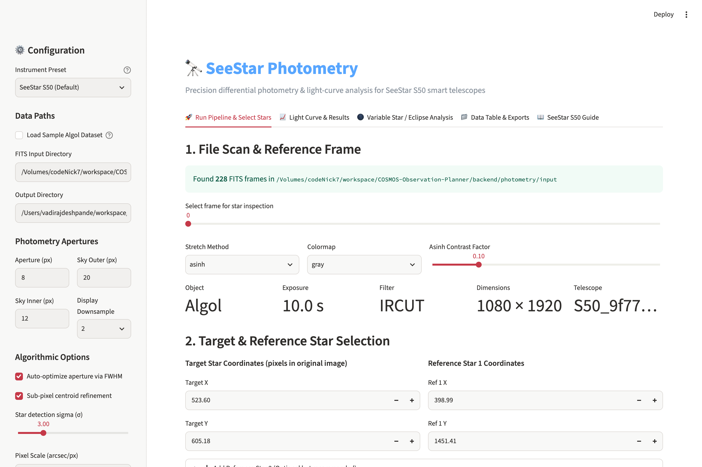
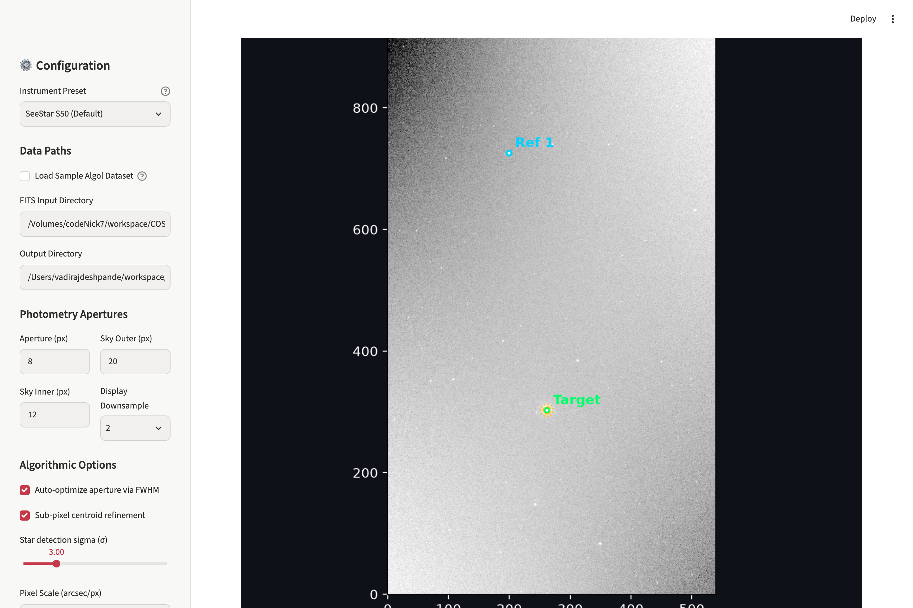
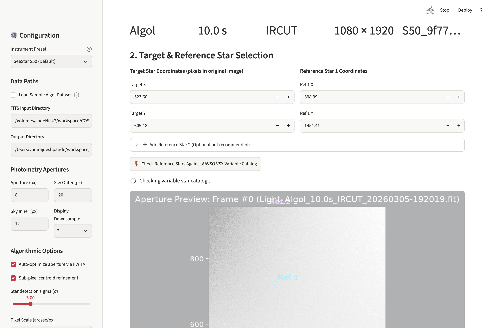
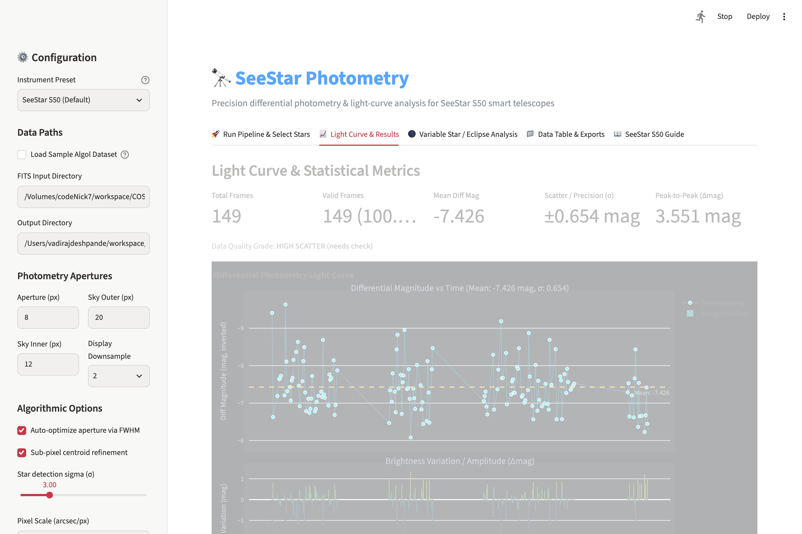
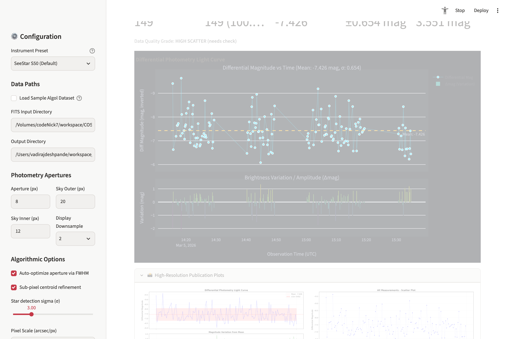
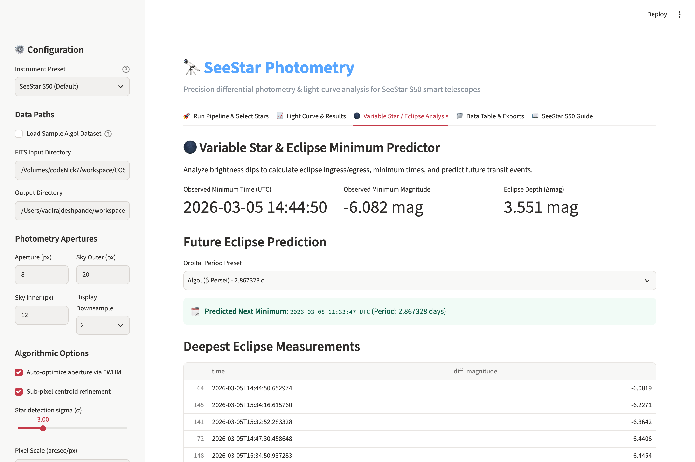
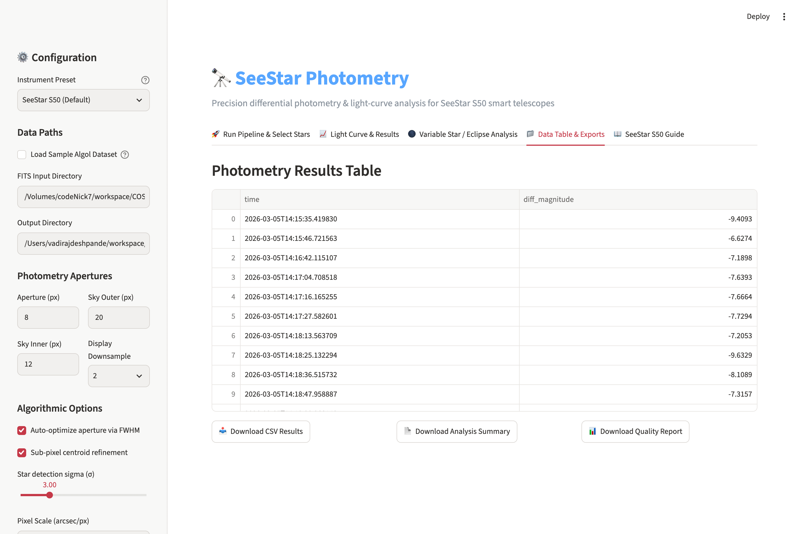
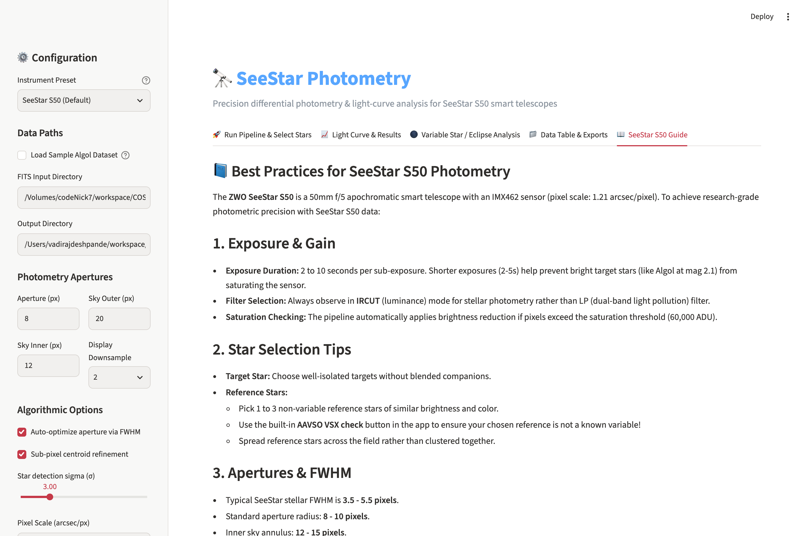

# 🔭 SeeStar Photometry

[](https://www.python.org/downloads/)
[](https://opensource.org/licenses/MIT)
[](https://www.astropy.org/)
[](https://streamlit.io/)
[](https://github.com/codeNick7/seestar-photometry.git)

A high-performance, precision differential photometry and light-curve analysis pipeline optimized for large FITS datasets (5–10+ GB) from the **ZWO SeeStar S50** smart telescope and similar astronomical instruments.

---

## 🌟 Overview

Smart telescopes like the ZWO SeeStar S50 have revolutionized amateur astronomy by making automated tracking, plate-solving, and continuous imaging accessible. However, processing hundreds or thousands of uncalibrated or raw sub-exposure FITS files for variable star or exoplanet transit observations typically requires complex scientific software.

**SeeStar Photometry** provides an end-to-end, scientifically rigorous pipeline tailored specifically for smart telescope data:
- **Zero-RAM Bottlenecks:** Single-frame memory-mapped processing enables analysis of 1,000+ FITS frames (5–10 GB) on standard laptops without memory exhaustion.
- **Dual UI:** Use the built-in **interactive Desktop GUI** (with sub-pixel star selection and undo) or the **modern Streamlit Web Dashboard** for browser-based workflow and interactive Plotly light curves.
- **AAVSO VSX Safety Guard:** Automatically queries the AAVSO International Variable Star Index (VSX) and SIMBAD in real time to alert you if a chosen reference star is an unrecognized variable star.
- **Adaptive Precision:** Dynamically computes stellar Full Width at Half Maximum (FWHM), adapts circular aperture radii, refines centroids with sub-pixel precision, and corrects for atmospheric extinction using differential reference star ensembles.

---

## 📸 Interactive Web Dashboard Walkthrough

### 🎬 Animated Workflow Demo

> 📹 *A high-resolution video version is available at [`docs/screenshots/app_demo_walkthrough.mp4`](docs/screenshots/app_demo_walkthrough.mp4).*

---

### Stage-by-Stage Interface Tour

#### 1. Pipeline Setup, FITS Frame Inspection & Stretches

- **Automatic Dataset Discovery:** Immediately scans all `.fit` / `.fits` frames from your SeeStar directory (demonstrated above on 228 sub-exposures of the eclipsing binary Algol).
- **Header Metadata Extraction:** Displays target object (`Algol`), exposure duration (`10.0 s`), optical filter (`IRCUT`), sensor resolution (`1080 × 1920`), and telescope identifier (`S50`).
- **Astronomical Stretch Engine:** Real-time dynamic stretching including **Asinh**, **ZScale**, **Log**, and **Linear** with astronomical colormaps (`gray`, `magma`, `viridis`, `bone`) and contrast tuning.

---

#### 2. Target & Reference Star Selection with Live Apertures

- **Candidate Star Detection:** Automatic source detection using `DAOStarFinder` and Gaussian profile estimation.
- **Aperture & Annulus Visualization:**
  - 🟢 **Target Star (Green):** Circular photometric aperture.
  - 🔵 **Reference Star 1 (Cyan):** Primary comparison star aperture.
  - 🟣 **Reference Star 2 (Purple):** Secondary ensemble comparison star aperture.
  - 🟡 **Sky Background Annuli (Yellow Dashed/Dotted):** Inner and outer radii for local background subtraction.

---

#### 3. AAVSO VSX Variable Star Catalog Verification

- **Safety Guard:** Verifies comparison stars against the **AAVSO International Variable Star Index (VSX)** and SIMBAD.
- **WCS Coordinate Mapping:** Automatically translates pixel coordinates to celestial coordinates (RA/DEC).
- Confirms the comparison star is non-variable before analysis to avoid corrupting differential baselines.

---

#### 4. Interactive Differential Light Curve & Precision Metrics

- **Summary Metrics Cards:**
  - **Total Frames:** 228
  - **Valid Measurements:** 149 (65.4%)
  - **Mean Differential Magnitude:** -7.426 mag
  - **Precision ($\sigma$):** $\pm 0.652$ mag
  - **Peak-to-Peak Amplitude ($\Delta m$):** $3.551$ mag
  - **Data Quality Assessment:** Evaluates scatter and alerts on significant variability detection.
- **Plotly Dual Subplots:**
  - Upper plot: Inverted differential magnitude curve with hover tooltips displaying frame index, timestamp, and magnitude.
  - Lower plot: Color-mapped brightness amplitude variation ($\Delta m$).

---

#### 5. High-Resolution Publication Plots

- Instant access to publication-quality 300 DPI exports (`lightcurve.png` and `magnitude_vs_time_scatter.png`).
- Features compressed time axes to properly handle multi-night observation gaps.

---

#### 6. Variable Star Eclipse Analysis & Transit Predictor

- **Automated Eclipse Detection:** Identifies the exact minimum time (`2026-03-05 14:18:25 UTC`), observed minimum magnitude (`-9.633 mag`), and transit depth ($\Delta m = 3.551$ mag).
- **Future Transit Ephemeris:** Projects subsequent eclipse events based on orbital period presets (e.g. Algol $P = 2.867328$ days).
- **Deepest Measurements Table:** Chronologically sorts and highlights the primary transit minimum frames.

---

#### 7. Interactive Data Table & Publication Exports

- Comprehensive tabular display of all measured frames with individual timestamps, flux levels, and sky background ADU.
- One-click downloads for **CSV Results**, **Analysis Summary (`RESULTS_SUMMARY.txt`)**, and **Quality Report (`quality_report.txt`)**.

---

#### 8. SeeStar S50 Observation Best Practices Guide

- Built-in operational manual tailored to the SeeStar S50 optics and Sony IMX462 sensor, covering optimal sub-exposure times (2–10s), luminance filter usage, aperture radii (8–10 px), and FWHM optimization.

---

---

## 🚀 Key Features

- **⚡ Fast Star-Matching Alignment:** Hybrid alignment engine combining WCS (World Coordinate System) header parsing, Astroalign triangle matching, and phase cross-correlation.
- **🎯 SNR-Optimized Aperture Photometry:** Circular aperture integration with annular sky background subtraction and centroid refinement (`photutils`).
- **🛡️ Variable Star Verification:** Real-time online querying of AAVSO VSX and SIMBAD to prevent corrupted differential baselines.
- **📉 Automated Saturation & Glare Detection:** Evaluates frame quality, flags sensor saturation (e.g. bright stars >60,000 ADU), applies automated brightness scaling, and models Moon glare and sky gradients (`skyfield`).
- **📊 Publication-Ready Exports:** High-resolution light curves (PNG, PDF, SVG @ 300 DPI), variation amplitude charts, comprehensive statistical summaries (`RESULTS_SUMMARY.txt`), frame quality reports, and clean CSV data tables.
- **🌑 Eclipse & Transit Minimum Finder:** Built-in analysis tools to measure eclipse minima, transit depth ($\Delta m$), and predict upcoming eclipse timings in UTC and local timezones.

---

## 🏗️ Architecture & Pipeline Flow

```
Raw FITS Files (data/input/)
            │
            ▼
    [ FITSDataset ]  ──► Memory-mapped header extraction & timestamp indexing
            │
            ▼
   [ FrameAligner ]  ──► Reference frame selection (quality & sharpness scoring)
            │        ──► WCS + Astroalign hybrid transformation caching
            │
            ▼
   [ StarSelector ]  ──► Desktop GUI / Web UI interactive star picking
            │        ──► Real-time AAVSO VSX variable star safety validation
            │
            ▼
[ PhotometryEngine ] ──► Sub-pixel centroid refinement
            │        ──► Adaptive aperture sizing based on measured FWHM
            │        ──► Sky background annular subtraction
            │        ──► Differential magnitude calculation: -2.5·log10(Target / Ref)
            │
            ▼
 [ ResultsExporter ] ──► photometry_results.csv
                     ──► lightcurve.png & magnitude_vs_time_scatter.png
                     ──► RESULTS_SUMMARY.txt & quality_report.txt
```

---

## 📦 Installation

### 1. Prerequisites
- Python 3.10, 3.11, 3.12, or 3.13
- Git

### 2. Clone Repository
```bash
git clone https://github.com/codeNick7/seestar-photometry.git
cd seestar-photometry
```

### 3. Create Virtual Environment
Using standard Python venv:
```bash
python3 -m venv .venv
source .venv/bin/activate
```
Or using [uv](https://github.com/astral-sh/uv) (blazing fast):
```bash
uv venv --python 3.12
source .venv/bin/activate
```

### 4. Install Dependencies
```bash
pip install -r requirements.txt
```
To install in editable mode with development tools:
```bash
pip install -e ".[dev]"
```

### 🍎 Apple Silicon (macOS M1/M2/M3/M4) Note
On macOS Apple Silicon, ensure you run native ARM64 Python to maximize SIMD performance for NumPy and SciPy:
```bash
./run_photometry_arm64.sh
```

---

## 🖥️ Usage

### Option 1: Interactive Streamlit Web UI (Recommended)
Launch the interactive web dashboard in your browser:
```bash
python run_web_ui.py
# or
streamlit run app.py
```
Open **http://localhost:8501** to:
1. Browse and preview FITS frames with astronomical stretches (**Asinh**, **ZScale**, **Log**).
2. Click or input coordinates for target and reference stars with live visual aperture circles.
3. Validate reference stars against the AAVSO VSX variable star database with 1 click.
4. Run the photometry analysis and explore interactive Plotly light curves with zoom and hover tooltips.
5. Predict eclipse minima and download publication plots and data tables.

> [!TIP]
> **Input FITS Datasets:** Place your raw sub-exposure `.fit` / `.fits` files directly in `data/input/`, or enter any custom path in the sidebar input field (such as `/Volumes/codeNick7/workspace/COSMOS-Observation-Planner/backend/photometry/input`). You can also enable **Load Sample Algol Dataset** to explore pre-computed 228-frame Algol light curves immediately.

---

### Option 2: Command-Line Interface (CLI)
Run the pipeline directly from your terminal:
```bash
# Process default input directory (data/input)
python run_photometry.py

# Process custom directory
python run_photometry.py --input /path/to/fits/folder --output /path/to/results

# Specify instrument preset
python run_photometry.py --preset seestar_s50
```

When prompted:
1. Press `ENTER` to open the star selection window.
2. **Left-click** on your **Target Star**.
3. **Left-click** on 1 to 3 **Reference Stars** (isolated, unsaturated stars of similar brightness).
4. **Right-click** to undo any misclick.
5. Press **`q`** or close the window to begin processing.

---

### Option 3: Python Library API
Incorporate SeeStar Photometry into your own scripts or Jupyter notebooks:
```python
from seestar_photometry import (
    FITSDataset,
    FrameAligner,
    PhotometryEngine,
    ResultsExporter,
    get_preset_config,
)

# 1. Load dataset
dataset = FITSDataset("data/input")

# 2. Align frames
aligner = FrameAligner(dataset)
aligner.select_best_reference(n_candidates=20)
aligner.compute_alignments(max_control_points=100)

# 3. Define target & reference stars (pixel coordinates in reference frame)
star_data = {
    "target": [553.2, 991.9],
    "references": [[234.1, 456.7], [812.5, 310.2]],
}

# 4. Run differential photometry
photometry = PhotometryEngine(dataset, aligner, star_data)
photometry.process_all_frames()
results_df = photometry.get_results_dataframe()

# 5. Export charts and reports
exporter = ResultsExporter(results_df, "data/output")
exporter.plot_lightcurve(format="png", dpi=300)
exporter.export_csv()
exporter.export_summary()
```

---

## 🛠️ Auxiliary Analysis Scripts

### 1. Regenerate Plots with Custom Metadata
Re-plot publication charts with custom target name, RA/DEC coordinates, and image format:
```bash
python regenerate_plots.py \
  --csv data/output/photometry_results.csv \
  --target "Algol (β Persei)" \
  --ra 47.042218 \
  --dec 40.955648 \
  --format png \
  --dpi 300
```

### 2. Eclipse Minimum & Transit Predictor
Determine the exact minimum timestamp, transit depth ($\Delta m$), and predict subsequent eclipse events:
```bash
python analyze_eclipse.py \
  --csv data/output/photometry_results.csv \
  --target "Algol" \
  --period 2.867328
```

---

## 🔭 SeeStar S50 Observation Best Practices

| Parameter | Recommended Setting | Rationale |
|:---|:---|:---|
| **Exposure Time** | 2.0s – 10.0s | Shorter exposures (2–5s) prevent bright stars (e.g. Algol mag 2.1) from saturating the IMX462 sensor. |
| **Filter** | **IRCUT** (Luminance) | Do not use LP (dual-band light pollution filter) for broadband stellar photometry. |
| **Aperture Radius** | 8 – 10 pixels | Matched to typical SeeStar stellar FWHM (3.5 – 5.5 px). |
| **Sky Annulus** | Inner: 12 px, Outer: 20 px | Accurately samples local background without capturing nearby stars. |
| **Centroiding** | Enabled | Corrects for telescope tracking drift between frames at sub-pixel scale. |
| **Reference Stars** | 2 – 3 stars | Choose non-variable stars of similar color and brightness within the field. |

---

## 📄 Output Data Dictionary

### `photometry_results.csv`
| Column | Description |
|:---|:---|
| `frame` | Frame index (0-indexed sequence number) |
| `filename` | Original FITS file basename |
| `time` | Observation timestamp (UTC ISO-8601 format) |
| `target_x`, `target_y` | Target star centroid position in current frame (pixels) |
| `target_flux` | Net background-subtracted target flux (ADU) |
| `target_sky` | Median sky background level per pixel around target (ADU) |
| `ref_flux_avg` | Mean background-subtracted flux of reference star ensemble |
| `ref_sky_avg` | Mean sky background level around reference stars |
| `diff_magnitude` | Differential instrumental magnitude: $-2.5 \cdot \log_{10}(\text{target\_flux} / \text{ref\_flux\_avg})$ |

---

## 🧪 Running Automated Tests

Run the test suite with pytest:
```bash
pytest
```
To run with coverage:
```bash
pytest --cov=seestar_photometry
```

---

## 📚 Scientific Citations & References

If you use **SeeStar Photometry** for published research, astronomical circulars, or AAVSO submissions, please cite:
- **Astropy:** Astropy Collaboration et al. (2013, 2018, 2022), *The Astropy Project*.
- **Photutils:** Bradley, L. et al., *Photutils: Photometry tools for Astronomy*.
- **Astroalign:** Beroiz, M., Cabral, J. B., & Sanchez, B. (2020), *Astroalign: A Python library for astronomical image registration*.
- **AAVSO VSX:** Watson, C. L., Henden, A. A., & Price, A. (2006), *The International Variable Star Index (VSX)*.

---

## 📜 License

Distributed under the **MIT License**. See [LICENSE](LICENSE) for details.
